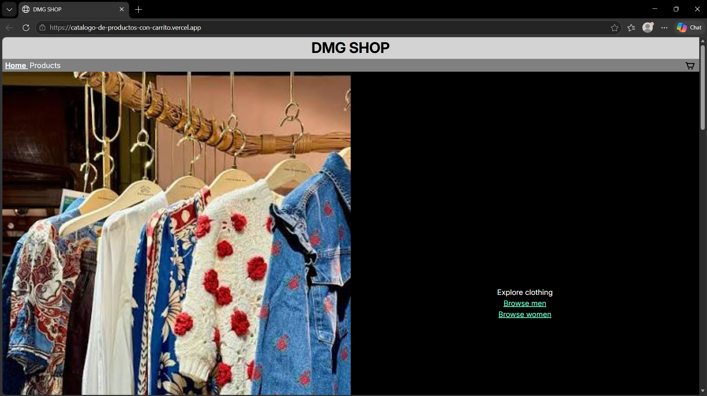
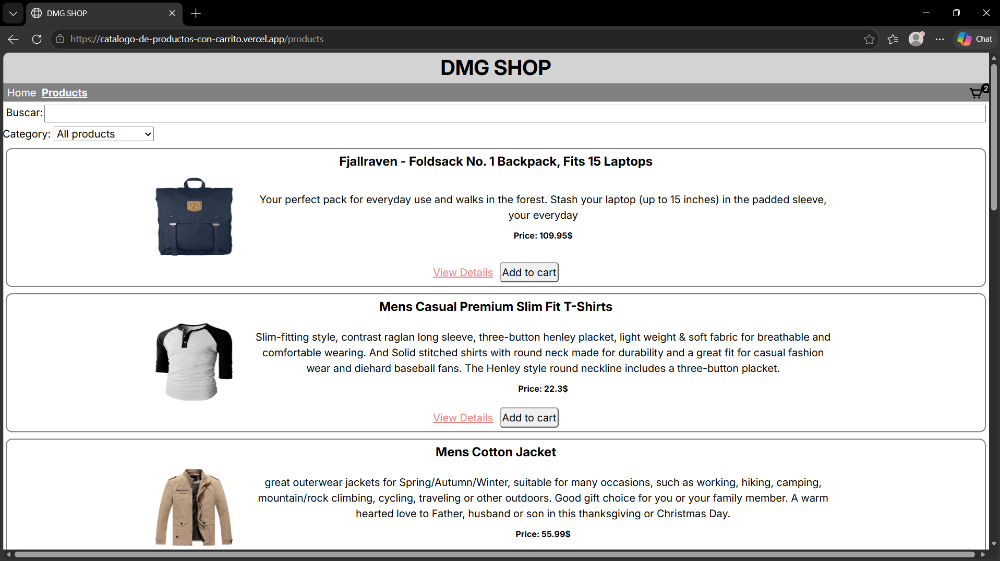
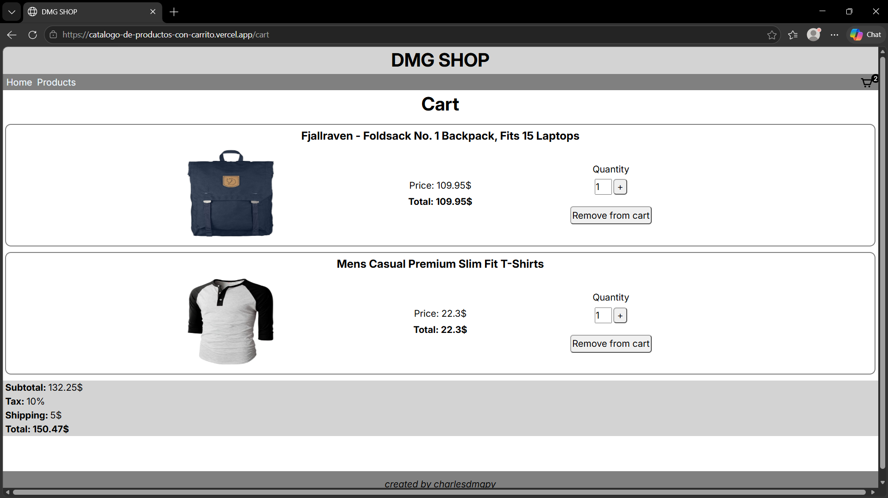

# Project IDEA

The shop will let you browse products and add them/delete them from the cart.
You can edit the quantities and the cart stays after refreshing.
The cart total is calculated.

## Case

My case is case A, because the products come from an API.

## API

The API in use is FakeStoreAPI

## Setup commands

1. npm install
2. npm run dev

## Pages

Home, Catalog, Product Details, Cart and NOT FOUND

## Main Features

Search: You can search your products in the search bar.
Category filters: You can add a filter by category.
Pagination: Each page shows up to 10 products, if more paginates the website wth Previous and next controls.
Cart: You can add to cart, and edit desired qty.
Persistence: The cart persist during refresh, and across pages thanks to LocalStorage and CartContext.

## Live App Link

https://catalogo-de-productos-con-carrito.vercel.app

## DEMO

Taxes: 10%
Shipping: 5$

DEMO ONLY

